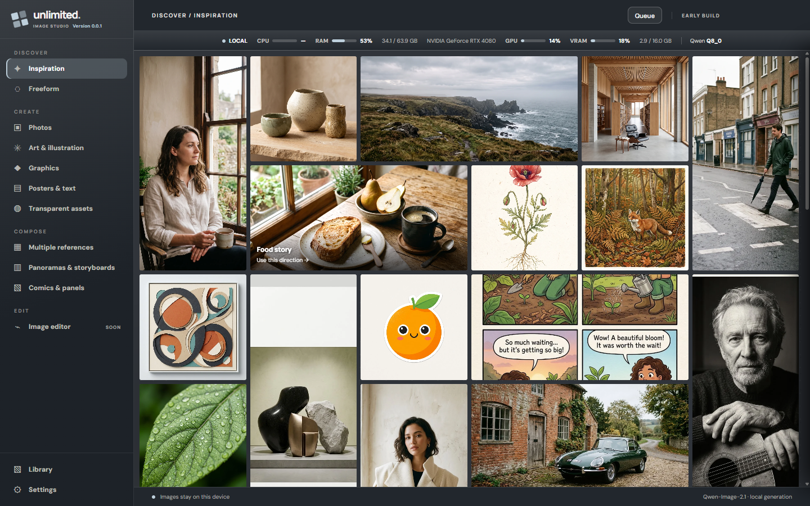
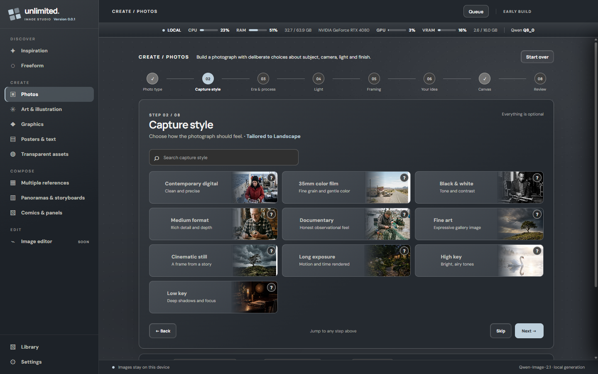
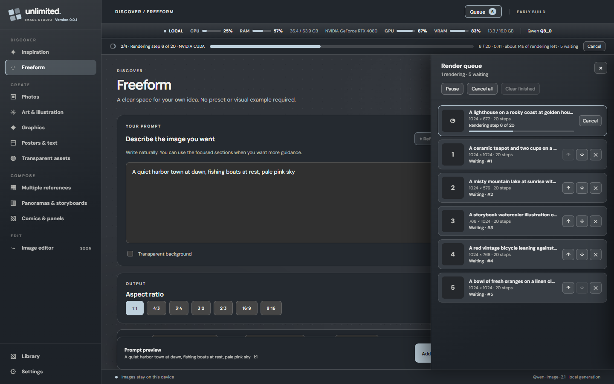
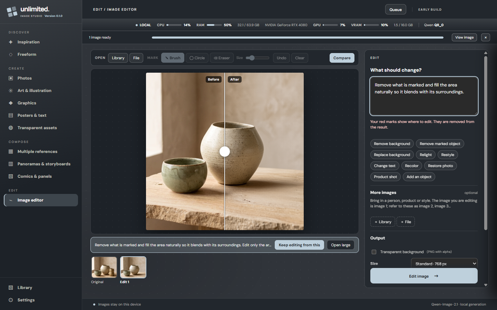
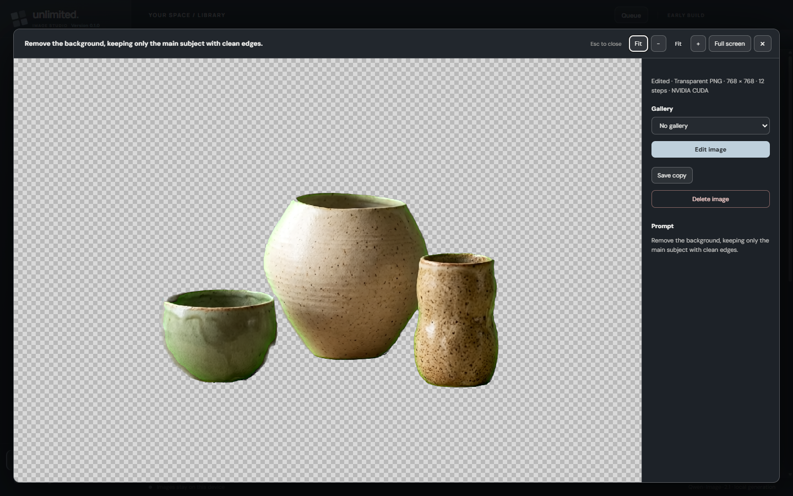
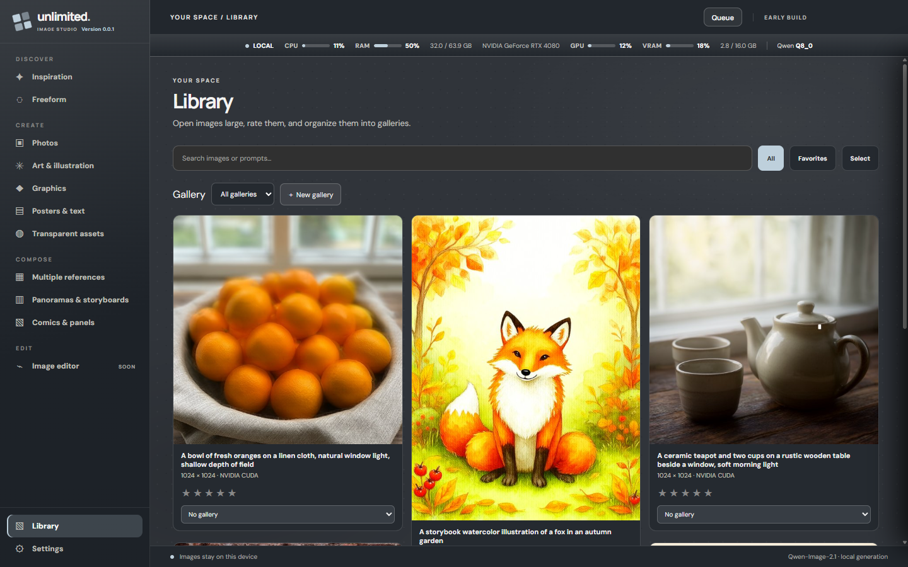
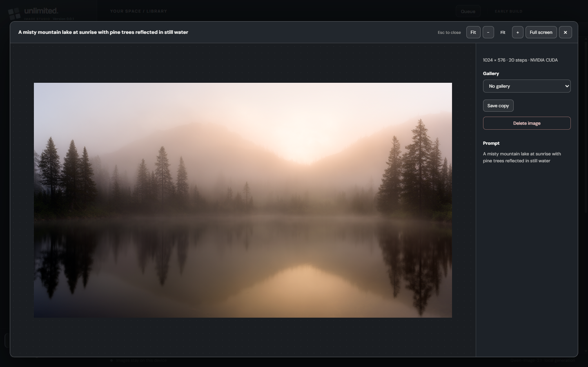

# Unlimited Image Studio

A portable, fully local AI image studio for Windows. It runs **Qwen-Image-2.1** on your own graphics card through [stable-diffusion.cpp](https://github.com/leejet/stable-diffusion.cpp). There is no account, no cloud service and no usage limit: prompts and images never leave your machine.

> **v0.1.0 adds the image editor.** Generation, editing, multiple references, transparent images, the render queue and the Library all work. AI prompt refinement is not built yet (see [What's not done yet](#whats-not-done-yet)).



## What it does

- **Guided prompt builder.** Photos, Art & illustration, Graphics, Posters & text, Transparent assets, Panoramas & storyboards and Comics. Each step offers choices with visual examples and a short explanation, and later choices adapt to earlier ones. Everything is optional, and a **Freeform** page is there when you just want to type.
- **Image editor.** Open any image (from the Library, a file, drag and drop or paste) and describe the change in plain words. Qwen-Image-2.1 edits natively, so the rest of the picture stays as it was. Mark *where* to edit with a brush or circle, bring in up to 9 more images (people, products, styles) as image 2, image 3 and so on, and compare before and after with a slider. One-click starters cover removing the background, removing or adding objects, replacing the background, relighting, restyling, changing text, recoloring, restoring old photos and product shots. Every result is a new Library image, and you can keep editing from any version.
- **Transparent images.** The Transparent assets page and the Freeform toggle produce real transparent PNGs. Transparent edits, such as removing a background, use a green-screen pass that the app keys out locally, so bright green parts of a subject can turn see-through.
- **Multiple references.** Combine up to ten images into one picture.
- **Inspiration wall.** Start from a direction you like and add your own subject.
- **Render queue.** Queue as many images as you like, from any page, with different settings for each. Generate up to 8 variations of a prompt at once. Reorder, pause, cancel, and see live progress with a time estimate. Waiting jobs survive closing the app and come back paused until you resume.
- **Library.** PNG originals and their prompts are stored beside the app. Rate images, organize them into galleries, select several at once, and delete (to the Recycle Bin, with Undo). A full-size viewer has zoom and full screen.
- **Themes.** Four built-in themes and your own colors, shared with the setup screen.
- **Portable.** One EXE. Models, runtime, settings and images live in folders next to it, so updating means replacing only the EXE.

| Guided builder | Render queue |
|---|---|
|  |  |

| Image editor: compare before and after | Background removed, as a transparent PNG |
|---|---|
|  |  |

| Library | Image viewer |
|---|---|
|  |  |

## Requirements

- Windows 10 or 11, 64-bit.
- A graphics card. An **NVIDIA** card is the validated path (CUDA). Other cards fall back to Vulkan, and CPU rendering works but is much slower. Vulkan, CPU and the lighter model weights have had less hands-on testing than CUDA.
- Disk space for the first-time download. Roughly 11 to 16 GB depending on the model weight and GPU. The size is shown before anything downloads.
- Graphics memory decides which model weight is offered:

| Weight | Needs about |
|---|---|
| Q2_K | any |
| Q3_K | 4 GB |
| Q4_K | 6 GB |
| Q6_K | 10 GB |
| Q8_0 | 14 GB |

On first launch the app detects your graphics card, suggests a weight, and downloads the model, text encoder and runtime next to the EXE. Downloads resume if interrupted and every file is checked against a pinned size and SHA-256. Model files are **not** part of this repository.

## Speed

Measured on one machine (RTX 4080 16 GB, Q8_0 weight, 12 steps): a 512 px image takes about 12 seconds and a 1024 px image about 40 seconds, after the model is loaded. An edit at 768 px takes about 100 seconds, most of it spent reading your image on the CPU. With a lighter weight (Q4_K or below on a 16 GB card, or any weight that leaves room on a larger card), the app reads the image on the GPU instead and an edit takes about 45 seconds. In one test the Q4_K weight missed an edit that Q8_0 got right, so lighter weights trade some editing accuracy for speed. Your results will depend on your card, the weight, the image size and the step count.

## Build from source

```bash
npm install
npm run test:bootstrap   # unit tests
npm run build:portable   # produces release/Unlimited-Image-Studio.exe
```

`npm run dev` starts the app with Electron directly. In that mode it keeps its files in `release-dev/` and skips the first-run setup.

See [PORTABLE_RELEASE.md](PORTABLE_RELEASE.md) for the folder layout and update behavior, and [prototype/README.md](prototype/README.md) for the original interface design notes (parts of it predate the current look).

## What's not done yet

- **AI prompt refinement.** The button is a placeholder. The design is in [prototype/PROMPT_ASSISTANCE.md](prototype/PROMPT_ASSISTANCE.md).
- **Qwen-Image-2.1 Turbo** (8-step generation and editing) is not supported yet.

## Credits and licenses

- Image model: [Qwen-Image-2.1](https://github.com/QwenLM/Qwen-Image-2.1). Its license applies to the weights you download.
- Runtime: [stable-diffusion.cpp](https://github.com/leejet/stable-diffusion.cpp).
- Fonts: DM Sans and Manrope, under the SIL Open Font License (see `prototype/assets/fonts`).

If you enjoy the project, you can [buy me a coffee](https://buymeacoffee.com/criso2hdj).
